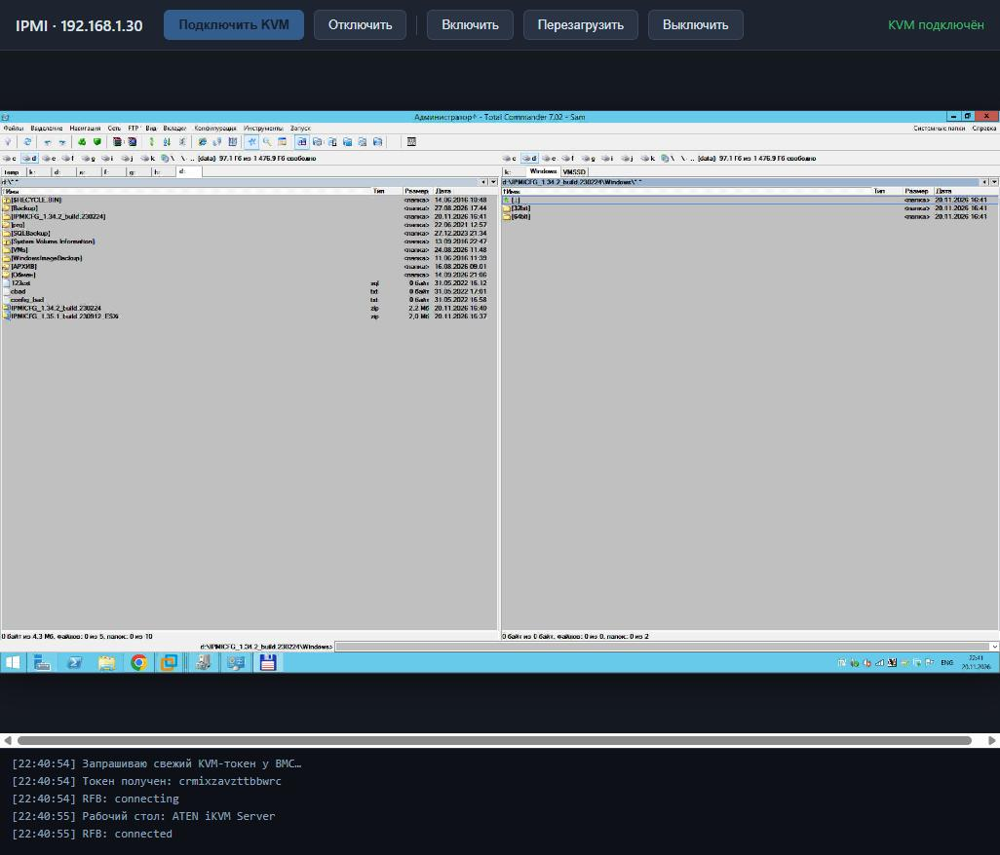

# IPMI Web-KVM for Supermicro (ATEN iKVM)

**English** | [Русский](README.md) | [中文](README.zh-CN.md)

A web client for remote IPMI/BMC access on Supermicro servers with an ATEN chip —
**no Java, no launch.jnlp, right in your browser**.

## Screenshots



*1920×1080 KVM console in fit-to-window mode, live sensor panel
(temperatures, fans, voltages) and power controls.*

## Features

- **KVM console in the browser** — video stream from the server screen, keyboard
  and mouse (ATEN RFB protocol on port 5900 via a WebSocket bridge, rendering by
  a noVNC fork).
- **Live sensors** — temperatures (CPU, system, PCH, memory), fans (RPM),
  voltages (12V/5V/3.3V/Vcpu/VDIMM etc.), chassis intrusion. Auto-refresh every
  5 seconds with color-coded threshold indicators.
- **Power control** — power on, graceful shutdown (ACPI), reset, power cycle,
  immediate power off.
- **System information** — BMC firmware version, MAC/IP, kernel, power status.
- **Screen scaling** — fit to window / 100% / 75% / 50% / 33%, with correctly
  synchronized mouse coordinates.
- **Video quality control** — requests the highest ATEN quantization (0xB) and
  4:4:4 chroma (no subsampling) for crisp text; medium/bandwidth-saver presets
  available. Optional pixelated rendering (no smoothing) keeps text sharp at
  any scale.
- **Keyboard grab toggle** — `Ctrl+Shift+X` switches keyboard input between the
  remote server and your local OS.
- **Sticky modifiers and Ctrl+Alt+Del** — latching Ctrl / Alt / Win buttons to
  compose any key combination, plus a dedicated Ctrl+Alt+Delete button.
- **One-click launch** — `IPMI-консоль.bat` starts the bridge and opens the page.

## How it works

```
Browser ──HTTP/WS──► ipmi_server.py ──► BMC (Supermicro)
 (noVNC-ATEN)       │  HTTP :7100        │ 80  — CGI (login, tokens, sensors, power)
                    │  WS   :5700 ──────►│ 5900 — RFB/video (ATEN iKVM)
                    └─ Python + websockets
```

A browser cannot open raw TCP connections or bypass CORS, so a small local
bridge is required: it logs into the BMC, obtains a one-time KVM token from a
fresh JNLP and proxies WebSocket to TCP port 5900. ATEN authorization:
login = password = token from the JNLP, each field NUL-padded to 24 bytes.

The ATEN iKVM protocol is implemented in a noVNC fork
([kelleyk/noVNC](https://github.com/kelleyk/noVNC), `bmc-support` branch,
bundled in `novnc-aten/`) with patches for older firmware: a 24-byte
authorization header and native 32-bit color for the AST2100 encoding.

## Quick start

1. Install Python 3.8+ and the `websockets` package:

   ```
   pip install websockets
   ```

2. Copy `config.example.bat` to `config.bat` and fill in your BMC address
   and credentials:

   ```
   set BMC_HOST=192.168.1.100
   set BMC_USER=ADMIN
   set BMC_PWD=your_password
   ```

   (`config.bat` is in `.gitignore` and will never be committed.)

3. Run **`IPMI-консоль.bat`** (or `python ipmi_server.py` and open
   `http://localhost:7100/ipmi.html`).

4. Click **«Подключить KVM»** (Connect KVM).

## Tested on

- Supermicro X7SB3, IPMI firmware 0135 (ATEN iKVM, `iKVM__V1.69.21`).

The approach applies to other Supermicro boards with Java-only iKVM
(X7/X8/X9/X10 on ATEN).

## Limitations

- The BMC allows only one KVM session at a time.
- The KVM token is single-use and is fetched from a fresh JNLP before each
  connection.
- If the JNLP comes back empty ("console in use"), a BMC reset helps
  (`POST /cgi/BMCReset.cgi` — restarts only the BMC, ~90 seconds).

## Files

| File | Purpose |
|---|---|
| `ipmi_server.py` | HTTP API + WebSocket→TCP bridge |
| `ipmi.html` | Console page (KVM, sensors, power, info) |
| `IPMI-консоль.bat` | One-click launcher |
| `novnc-aten/` | noVNC fork with ATEN support (MPL 2.0) |
| `test_aten.py` | Direct ATEN handshake test |
| `test_e2e.py` | End-to-end test: API + bridge + handshake |
| `CHANGELOG.md` | Version history |

## Licenses

The code in this repository is MIT licensed. The `novnc-aten/` directory is a
derivative of noVNC (MPL 2.0, © the noVNC authors and kelleyk), see
`novnc-aten/LICENSE.txt`.
