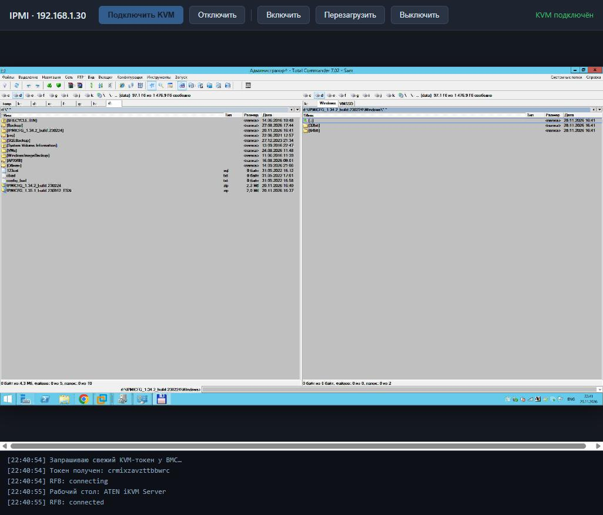

# IPMI Web-KVM для Supermicro (ATEN iKVM)

[English](README.en.md) | **Русский** | [中文](README.zh-CN.md)

Веб-клиент удалённого доступа к IPMI/BMC серверов Supermicro с чипом ATEN —
**без Java, без launch.jnlp, прямо в браузере**.

## Скриншоты



*KVM-консоль 1920×1080 в режиме «вписать в окно», панель датчиков
(температуры, вентиляторы, напряжения) и управление питанием.*

## Возможности

- **KVM-консоль в браузере** — видеопоток с экрана сервера, клавиатура и мышь
  (RFB-протокол ATEN на порту 5900 через WebSocket-мост, рендеринг — форк noVNC).
- **Датчики в реальном времени** — температуры (CPU, система, PCH, память),
  вентиляторы (RPM), напряжения (12V/5V/3.3V/Vcpu/VDIMM и др.), состояние корпуса.
  Автообновление каждые 5 секунд, цветовая индикация порогов.
- **Управление питанием** — включение, корректное выключение (ACPI), reset,
  цикл питания, немедленное выключение.
- **Виртуальный CD-ROM** — монтирование ISO в BMC прямо из консоли: выбор
  ISO через диалог (загрузка и шара настраиваются автоматически) или любая
  SMB-шара вручную. Идеально для восстановления загрузчика и переустановки ОС.
- **Системная информация** — версия прошивки BMC, MAC/IP, ядро, статус питания.
- **Масштабирование экрана** — вписать в окно / 100% / 75% / 50% / 33%.
- **Настройка качества видео** — по умолчанию запрашивается максимум
  (квантование 0xB, цветность 4:4:4 без субдискретизации): текст в BIOS и
  консоли читается чётко. Режимы «среднее» и «экономия трафика», а также
  переключатель «Резкие пиксели» (без сглаживания при масштабировании).
- **Клавиатура: переключение ввода** — `Ctrl+Shift+X` переключает ввод между
  сервером и вашей ОС.
- **Залипающие модификаторы и Ctrl+Alt+Del** — кнопки Ctrl / Alt / ⊞ Win
  (зажимаются до повторного нажатия) для любых сочетаний, плюс готовая
  кнопка Ctrl+Alt+Delete.
- **Один клик для запуска** — `IPMI-консоль.bat` поднимает мост и открывает страницу.

## Как это работает

```
Браузер ──HTTP/WS──► ipmi_server.py ──► BMC (Supermicro)
 (noVNC-ATEN)        │  HTTP :7100        │ 80  — CGI (логин, токены, датчики, питание)
                     │  WS   :5700 ──────►│ 5900 — RFB/видео (ATEN iKVM)
                     └─ Python + websockets
```

Браузер не умеет сырой TCP и обход CORS, поэтому нужен небольшой локальный мост:
он логинится в BMC, получает одноразовый KVM-токен из свежего JNLP и проксирует
WebSocket в TCP-порт 5900. Авторизация ATEN: логин = пароль = токен из JNLP,
каждое поле дополняется NUL до 24 байт.

Протокол ATEN iKVM реализован в форке noVNC
([kelleyk/noVNC](https://github.com/kelleyk/noVNC), ветка `bmc-support`,
уже включён в `novnc-aten/`) с патчами под старые прошивки:
24-байтный заголовок авторизации и родной 32-битный цвет кодировки AST2100.

## Быстрый старт

1. Установите Python 3.8+ и пакет `websockets`:

   ```
   pip install websockets
   ```

2. Скопируйте `config.example.bat` в `config.bat` и укажите адрес и учётные
   данные вашего BMC:

   ```
   set BMC_HOST=192.168.1.100
   set BMC_USER=ADMIN
   set BMC_PWD=your_password
   ```

   (`config.bat` добавлен в `.gitignore` и не попадёт в репозиторий.)

3. Запустите **`IPMI-консоль.bat`** (или `python ipmi_server.py` и откройте
   `http://localhost:7100/ipmi.html`).

4. Нажмите **«Подключить KVM»**.

## Виртуальный CD-ROM (монтирование ISO)

1. В консоли нажмите **«📀 Выбрать ISO-файл…»** — образ загрузится на этот ПК
   в папку `iso_share` и расшарится как `\\<этот ПК>\ipmi_iso`.
2. Дайте BMC доступ к шаре — два варианта:
   - **через Windows SMB**: один раз запустите `ipmi-smb-setup.bat` (админ),
     затем `ipmi-smb-guest.bat` — и пароль не понадобится вовсе;
   - **если SMB Windows не работает** (или не хочется перезагружать ПК):
     `pip install impacket` и запустите `ipmi-smb-server.bat` — свой
     SMB-сервер на порту 445 с гостевым доступом (Windows-шара при этом
     приостанавливается до запуска `ipmi-smb-revert.bat`).
3. Нажмите **«Смонтировать»** — статус устройства станет «ISO смонтирован».
   После использования — **«Отмонтировать»**, а настройки Windows можно
   вернуть скриптом `ipmi-smb-revert.bat`.

## Проверено на

- Supermicro X7SB3, прошивка IPMI 0135 (ATEN iKVM, `iKVM__V1.69.21`).

Подход применим к другим платам Supermicro с Java-only iKVM (X7/X8/X9/X10 на ATEN).

## Ограничения

- BMC допускает только одну KVM-сессию одновременно.
- Токен KVM одноразовый и берётся из свежего JNLP перед каждым подключением.
- Если JNLP приходит пустым («консоль занята») — помогает перезапуск BMC
  (`POST /cgi/BMCReset.cgi`, перезагружает только BMC, ~90 секунд).

## Файлы

| Файл | Назначение |
|---|---|
| `ipmi_server.py` | HTTP API + WebSocket→TCP мост |
| `ipmi.html` | Страница пульта (KVM, датчики, питание, информация) |
| `IPMI-консоль.bat` | Запуск в один клик |
| `ipmi_smb_server.py` / `ipmi-smb-server.bat` | Свой SMB-сервер для ISO (гостевой доступ, нужен `impacket`) |
| `ipmi-smb-setup.bat` / `ipmi-smb-guest.bat` | Настройка Windows-шары для BMC |
| `ipmi-smb-revert.bat` | Откат всех системных изменений |
| `novnc-aten/` | Форк noVNC с поддержкой ATEN (MPL 2.0) |
| `test_aten.py` | Тест ATEN-рукопожатия напрямую |
| `test_e2e.py` | Сквозной тест: API + мост + рукопожатие |
| `CHANGELOG.md` | История изменений |

## Лицензии

Код этого репозитория — MIT. Каталог `novnc-aten/` — производная от noVNC
(MPL 2.0, © авторы noVNC и kelleyk), см. `novnc-aten/LICENSE.txt`.
