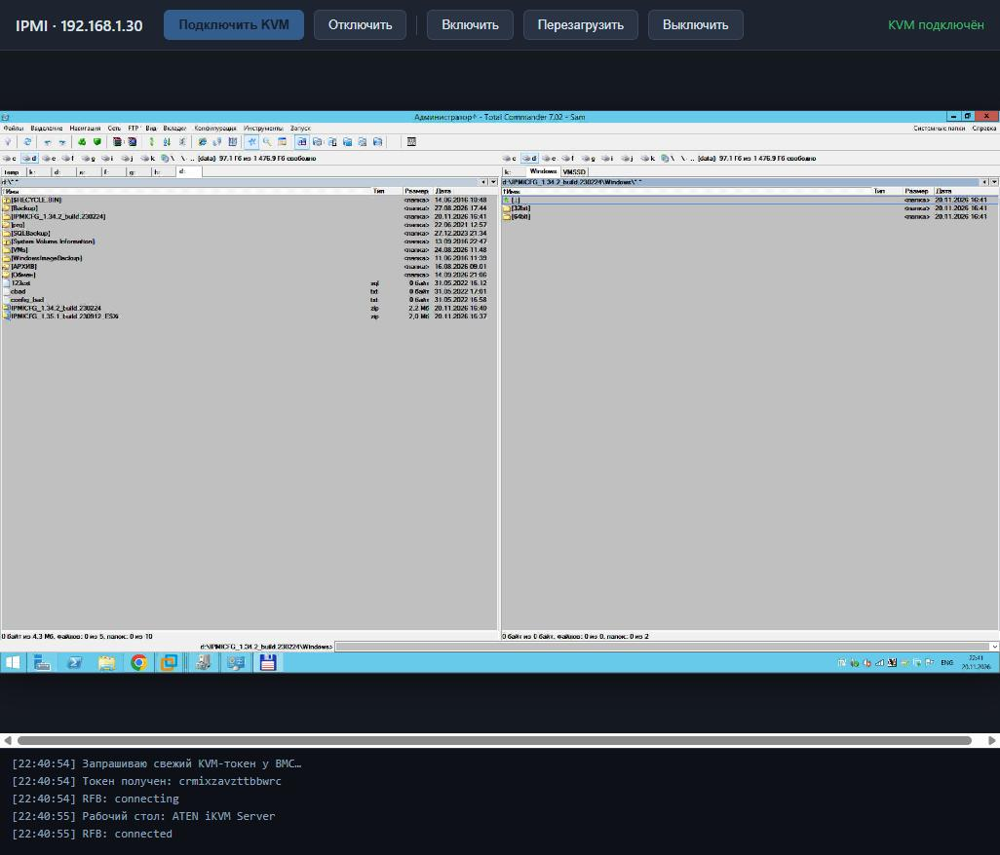

# Supermicro IPMI Web-KVM（ATEN iKVM）

[English](README.en.md) | [Русский](README.md) | **中文**

适用于带 ATEN 芯片的 Supermicro 服务器 IPMI/BMC 远程访问 Web 客户端——
**无需 Java、无需 launch.jnlp，直接在浏览器中使用**。

## 截图



*1920×1080 KVM 控制台（适应窗口模式）、实时传感器面板
（温度、风扇、电压）和电源控制。*

## 功能特性

- **浏览器 KVM 控制台**——服务器屏幕视频流、键盘和鼠标（ATEN RFB 协议，
  5900 端口，经 WebSocket 桥接，由 noVNC 分支渲染）。
- **实时传感器**——温度（CPU、系统、PCH、内存）、风扇转速（RPM）、
  电压（12V/5V/3.3V/Vcpu/VDIMM 等）、机箱入侵状态。每 5 秒自动刷新，
  阈值超限以颜色标记。
- **电源控制**——开机、ACPI 正常关机、重启、电源循环、强制断电。
- **系统信息**——BMC 固件版本、MAC/IP、内核版本、电源状态。
- **屏幕缩放**——适应窗口 / 100% / 75% / 50% / 33%，鼠标坐标精确同步。
- **键盘捕获切换**——按 `Ctrl+Shift+X` 在远程服务器与本地系统之间切换键盘输入。
- **一键启动**——`IPMI-консоль.bat` 自动启动桥接服务并打开页面。

## 工作原理

```
浏览器 ──HTTP/WS──► ipmi_server.py ──► BMC（Supermicro）
 (noVNC-ATEN)      │  HTTP :7100       │ 80  — CGI（登录、令牌、传感器、电源）
                   │  WS   :5700 ─────►│ 5900 — RFB/视频（ATEN iKVM）
                   └─ Python + websockets
```

浏览器无法建立原始 TCP 连接，也无法绕过 CORS，因此需要一个本地小桥接程序：
它登录 BMC，从最新的 JNLP 中获取一次性 KVM 令牌，并将 WebSocket 代理到
TCP 5900 端口。ATEN 授权方式：登录名 = 密码 = JNLP 中的令牌，
每个字段以 NUL 填充至 24 字节。

ATEN iKVM 协议基于 noVNC 分支实现
（[kelleyk/noVNC](https://github.com/kelleyk/noVNC)，`bmc-support` 分支，
已包含在 `novnc-aten/` 目录中），并针对旧固件打了补丁：
24 字节授权头和 AST2100 编码的原生 32 位颜色。

## 快速开始

1. 安装 Python 3.8+ 和 `websockets` 包：

   ```
   pip install websockets
   ```

2. 将 `config.example.bat` 复制为 `config.bat`，并填写您的 BMC 地址和凭据：

   ```
   set BMC_HOST=192.168.1.100
   set BMC_USER=ADMIN
   set BMC_PWD=your_password
   ```

   （`config.bat` 已加入 `.gitignore`，不会被提交。）

3. 运行 **`IPMI-консоль.bat`**（或运行 `python ipmi_server.py` 后打开
   `http://localhost:7100/ipmi.html`）。

4. 点击 **«Подключить KVM»**（连接 KVM）。

## 已验证平台

- Supermicro X7SB3，IPMI 固件 0135（ATEN iKVM，`iKVM__V1.69.21`）。

该方案同样适用于其他仅支持 Java iKVM 的 Supermicro 主板
（基于 ATEN 的 X7/X8/X9/X10 系列）。

## 限制说明

- BMC 同一时间只允许一个 KVM 会话。
- KVM 令牌为一次性使用，每次连接前都会从新的 JNLP 中获取。
- 如果 JNLP 返回为空（"控制台被占用"），可重启 BMC 解决
  （`POST /cgi/BMCReset.cgi`——仅重启 BMC，约 90 秒）。

## 文件说明

| 文件 | 用途 |
|---|---|
| `ipmi_server.py` | HTTP API + WebSocket→TCP 桥接 |
| `ipmi.html` | 控制台页面（KVM、传感器、电源、信息） |
| `IPMI-консоль.bat` | 一键启动脚本 |
| `novnc-aten/` | 支持 ATEN 的 noVNC 分支（MPL 2.0） |
| `test_aten.py` | ATEN 握手直接测试 |
| `test_e2e.py` | 端到端测试：API + 桥接 + 握手 |
| `CHANGELOG.md` | 版本历史 |

## 许可证

本仓库代码采用 MIT 许可证。`novnc-aten/` 目录为 noVNC 的衍生作品
（MPL 2.0，© noVNC 作者及 kelleyk），详见 `novnc-aten/LICENSE.txt`。
